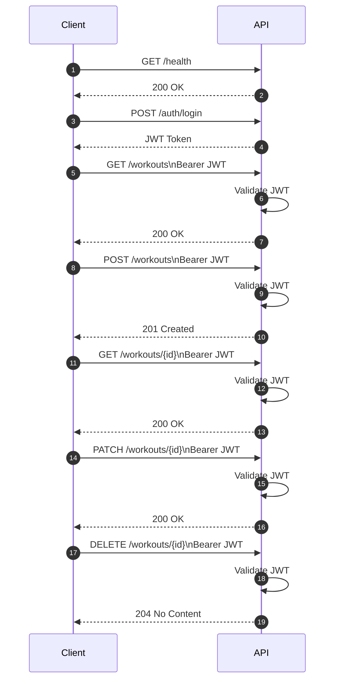

# Workout API

A minimal [TypeScript](https://www.typescriptlang.org/) and [Hono](https://hono.dev/) REST API for workouts.

The data is stored in memory: it starts empty and is lost when the process stops.

## Running the API

The backend server for the Workout API can be run either directly with Node.js or inside a Docker container. The instructions below assume that you are in the repository root.

Running the Docker container is the recommended approach, but you can also run the server directly with Node.js if you prefer.

> [!TIP]
> GitHub Actions Linux runners and GitHub Codespaces have both Node.js and Docker preinstalled, so either option works equally well for this exercise.


### Run with Docker Compose

If you have Docker installed, you can run the server with Docker Compose. From the repository root, run:

```bash
docker compose -f app/compose.yaml up
```

If you use Docker, you will not need Node.js or npm installed locally. The Docker container will install the dependencies and start the server within the container.

If you want, you can check the [Dockerfile](./Dockerfile) and [compose.yaml](./compose.yaml) to see how the container is built and run.

The API listens at `http://localhost:3000`. `GET /health` can be used for checking that the server is responding properly. Stop it with Ctrl+C, then you can remove the container with `docker compose -f app/compose.yaml down`.

The app reports at startup whether `GITHUB_ACTIONS` is `true`. GitHub Actions sets this variable on the runner, and Compose passes it into the container (defaulting to `false` when unset). This is an environment indicator, not proof that the app is running in GitHub Actions.

### Run with local Node.js

Install a maintained version of Node.js and then run:

```bash
cd app
npm install
npm start
```

The API listens at `http://localhost:3000`. Stop it with Ctrl+C. `GET /health` can be used for checking that the server is responding properly.

## Public endpoints

These endpoints do not require authentication:

| Method | Path | Result |
| --- | --- | --- |
| GET | `/` | `200` and welcome message in JSON format |
| GET | `/health` | `200` and `{"status":"ok"}` with other dummy fields |

The health check is a dummy: it always returns the same response and does not check dependencies or application state. It only demonstrates that the server is responding.

## Authentication and JWT

There is authentication, but there is no registration. The app loads example users and salted scrypt password hashes from `users.json` on startup:

| Username | Password |
| --- | --- |
| `xkcd` | `correct horse battery staple` |
| `spaceballs` | `12345` |

These are public exercise credentials inspired by popular culture, not real secrets. Do not reuse them for real accounts.

### Token-based authentication

The API uses JSON Web Tokens (JWT) for authentication. You can read an introduction to JWTs at [jwt.io](https://jwt.io/introduction/).

In a way, tokens are like session cookies: they are generated by the server and sent to the client, which must include them in subsequent requests. The server validates the token and grants access to protected endpoints.

The server signs tokens with a secret key, which is generated on each startup, so you cannot reuse a token from a previous session. Tokens are also valid for one hour.

### Getting a token

Send `POST /auth/login` with a JSON object containing `username` and `password`. Valid credentials return `200` and `{"token":"<JWT>"}`. Invalid credentials return `401` and an error message; malformed JSON or missing or non-string fields return `400` and an error message.

> For example, you can run the following command to log in as `xkcd` and receive a token. The server will respond with a JSON object containing the token, which you can then use in subsequent requests.
>
> ```bash
> curl -X POST http://localhost:3000/auth/login \
>   -H 'Content-Type: application/json' \
>   -d '{"username":"xkcd","password":"correct horse battery staple"}'
> ```
>
> The above command works on Unix-like systems like GitHub actions, codespaces or development containers. On Windows, you will need to modify the command.

### Using a token

Include the received token in an `Authorization: Bearer <JWT>` header on all requests other than `GET /`, `GET /health` and `POST /auth/login`. Missing, invalid or expired tokens return `401`.

Tokens expire after one hour. Restarting the REST api also invalidates them.

## Workout

Responses contain an `id` generated by the server, the owning user's `username`, a `name`, and a `durationMinutes`:

```json
{
  "id": "a-server-generated-id",
  "username": "xkcd",
  "name": "Morning run",
  "durationMinutes": 30
}
```

For create and update requests, send a JSON object with exactly `name` and `durationMinutes`. The server assigns the workout to the username in the authenticated token; clients cannot choose or change the owner. The name must be a non-empty string; leading and trailing whitespace is removed. The duration must be a positive integer. An update replaces both workout fields, rather than partially updating them.

| Method | Path | Result |
| --- | --- | --- |
| GET | `/workouts` | `200` and an array of the authenticated user's workouts (initially `[]`) |
| POST | `/workouts` | `201` and the created workout. The response also includes the workout's ID that was generated by the server. |
| GET | `/workouts/:id` | `200` and the matching workout, if it belongs to the authenticated user |
| PUT | `/workouts/:id` | `200` and the updated workout, with the same ID, if it belongs to the authenticated user |
| DELETE | `/workouts/:id` | `204` with an empty body, if it belongs to the authenticated user |

Requests to an individual workout return `404` and an error message if the ID does not exist or belongs to another user. Invalid or malformed JSON, missing fields, extra fields, and invalid field values return `400` and an error message on POST and PUT. PUT checks whether the workout belongs to the authenticated user before validating the request body.

> Example:
>
> The following example creates a workout named "Morning run" with a duration of 30 minutes for the user represented by the token. `<JWT>` needs to be replaced with the token received from `POST /auth/login`.
>
> ```bash
> curl -i -X POST http://localhost:3000/workouts \
>   -H 'Authorization: Bearer <JWT>' \
>   -H 'Content-Type: application/json' \
>   -d '{"name":"Morning run","durationMinutes":30}'
> ```
>
> This example uses `curl` and should work on Unix-like systems, like a codespace or a development container. You will need to modify the command if you are using Powershell or Windows Command Prompt.

## Sequence diagram



## Logging

Hono's request logger writes request methods, URLs, response status codes and timings to stdout and appends them to `app/logs/app.log`. The file persists across restarts and is ignored by Git. The app must have permission to write to the `app` directory. `APP_LOG_PATH` can override the file location; Docker Compose uses it to write to the mounted directory. URLs include query strings, so do not put passwords or tokens in them.
